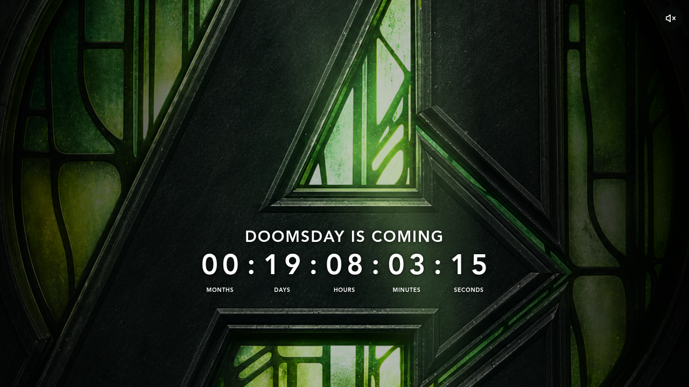

# Avengers: Doomsday — Philippines Countdown

A cinematic, fan-made countdown to **Avengers: Doomsday** — premiering **December 16, 2026 at 12:00 AM Philippine time (UTC+8)**.

[](https://zedthegreatt.github.io/Avengers-Doomsday-Countdown-PH)
[](https://avengers-doomsday-countdown-ph.pages.dev/)

## About

This is an unofficial, single-page countdown site built with static HTML, CSS, and JavaScript — no build step, no frameworks, and zero dependencies. The timer is explicitly anchored to Philippine time (UTC+8), so visitors in any time zone see the same Manila countdown.

It features an original Doom-inspired illustration, animated light rays, drifting dust particles, responsive typography, and optional clock-tick audio — all served from the `dist/` folder via GitHub Pages.

> ⚠️ Unofficial fan project. Not affiliated with, endorsed by, or sponsored by Marvel, Disney, or any related rights holders. All names and trademarks belong to their respective owners.

---

## Features

- 🕒 Counts down in **months, days, hours, minutes, and seconds**
- 🇵🇭 Anchored to **Philippine time (UTC+8)** — consistent for every visitor
- 📱 Fully responsive, single-page design (mobile & desktop)
- 🎨 Original Doom-inspired illustration + animated light rays
- ✨ Canvas-based drifting dust particle atmosphere
- 🔊 Optional clock-tick audio, controlled by an on-page sound button
- ♿ Accessible: `role="timer"`, ARIA labels, `prefers-reduced-motion` support, focus-visible states
- ⚡ Zero dependencies, no build step — just open `dist/index.html`

---

## Tech Stack

| Layer | Technology |
|-------|------------|
| Markup | HTML5 |
| Styles | CSS (custom fonts: Montserrat Bold, Avenir Arabic Heavy) |
| Logic | Vanilla JavaScript (no libraries) |
| Audio | `clock-tick.mp3` (looping, user-gated) |
| Graphics | HTML5 Canvas (dust particles) + `avengers-enhanced.png` |
| Hosting | GitHub Pages & Cloudflare Pages |
| CI/CD | GitHub Actions (deploys `dist/` on push to `main`) |

---

## Screenshot

> Add a screenshot of the live site here:
>
> ```markdown
> 
> ```
>
> Place the image at `assets/readme/screenshot.png` and uncomment the line above.

---

## Run Locally

Open `dist/index.html` directly, or serve the `dist` folder:

```sh
# Python
python -m http.server 8000 --directory dist
# → http://localhost:8000

# Node
npx serve dist
```

---

## Project Structure

```
Avengers-Doomsday-Countdown-PH/
├── dist/                        # Deployed site (served by GitHub Pages)
│   ├── index.html               # Entry point
│   ├── styles.css               # Styles
│   ├── countdown.js             # Countdown + sound logic
│   ├── dust.js                  # Canvas dust particles
│   ├── avengers-enhanced.png    # Hero illustration
│   ├── clock-tick.mp3           # Optional clock audio
│   └── fonts/                   # Custom web fonts
├── .github/workflows/main.yml   # GitHub Pages deploy workflow
├── .gitignore
└── README.md
```

---

## Customization

**Change the target date** — edit `dist/countdown.js`:

```js
const target = Date.parse("2026-12-16T00:00:00+08:00");
```

The `+08:00` offset anchors the timer to Philippine time.

**Change the sound** — replace `dist/clock-tick.mp3` (or update the `new Audio("...")` path in `countdown.js`).

---

## Deployment

Pushing to `main` triggers `.github/workflows/main.yml`, which deploys `dist/` to GitHub Pages. The workflow can also be run manually from the repository's **Actions** tab. A mirror is published on Cloudflare Pages.

---

## License & Credit

Unofficial fan-made project — no affiliation with Marvel, Disney, or related rights holders. All associated names and trademarks belong to their respective owners.

Built and maintained by [ZedTheGreatt](https://github.com/ZedTheGreatt).
